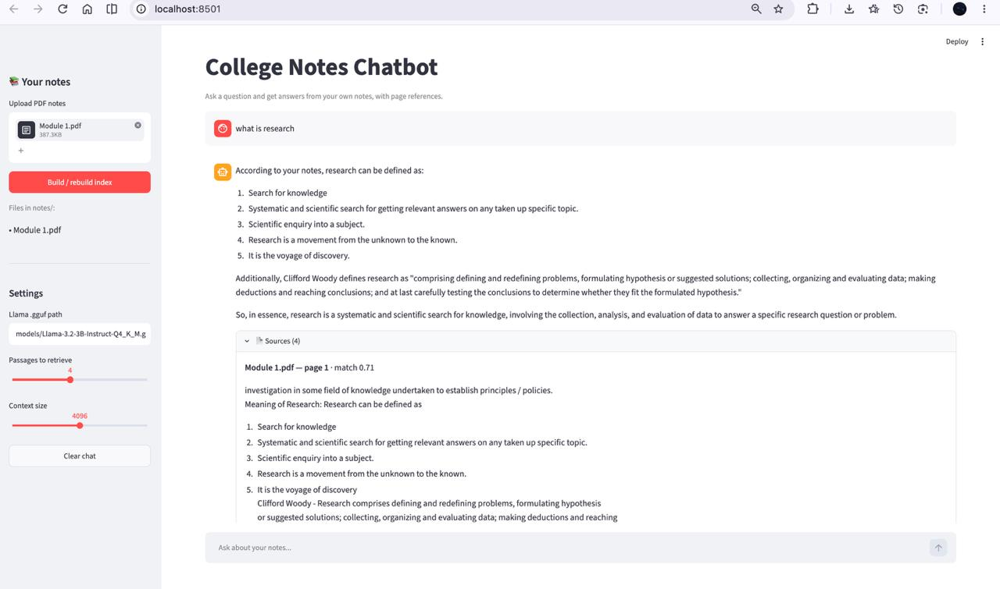

# 📚 College Notes Chatbot

A local, private **RAG (Retrieval-Augmented Generation)** chatbot that answers questions from your own college PDF notes. Built for quick revision before exams. Everything runs on your machine: no API keys, no cloud, no data leaving your laptop.

## Features

- Upload one or many PDF notes and ask questions in plain English
- Answers are generated **only from your notes**, and the bot says so when it can't find an answer
- Every answer shows its **sources** (file, page, match score and the exact passage)
- Fast semantic search with **FAISS**; the index is saved to disk and reused
- Runs a **local Llama** model, so it works offline
- Streamlit web UI and a simple command-line mode

## How it works

```
PDF notes
   │  pypdf (PDF loader)
   ▼
Pages ──► RecursiveCharacterTextSplitter ──► Chunks (800 chars, 150 overlap)
                                                │  all-MiniLM-L6-v2
                                                ▼
                                       Embeddings ──► FAISS index (saved to disk)

Question ──► embed ──► FAISS similarity search (top-k) ──► Relevant passages
                                                              │
                                    Local Llama (llama-cpp) ◄─┘
                                                              ▼
                                              Answer + source pages
```

## Tech stack

| Part | Tool |
|---|---|
| PDF loader | `pypdf` |
| Text splitter | `langchain-text-splitters` |
| Embeddings | `sentence-transformers` (`all-MiniLM-L6-v2`) |
| Vector database | `faiss-cpu` |
| Chat model | Local Llama (GGUF) via `llama-cpp-python` |
| UI | Streamlit |

## Project structure

```
college-notes-chatbot/
├── app.py               # Streamlit UI
├── notes_chatbot.py     # Core RAG pipeline + CLI
├── requirements.txt
├── notes/               # Put your PDFs here (ignored by git)
├── models/              # Put your .gguf model here (ignored by git)
├── .gitignore
├── LICENSE
└── README.md
```

## Setup

**Requirements:** Python 3.10+ and roughly 4–8 GB of free RAM for a small Llama model.

```bash
git clone 
cd college-notes-chatbot

python -m venv .venv
source .venv/bin/activate        # Windows: .venv\Scripts\activate

pip install -r requirements.txt
```

### Get a Llama model

Download a Llama chat model in **GGUF** format from Hugging Face (search for "Llama 3.2 3B Instruct GGUF") and place it in `models/`. A 3B model at `Q4_K_M` quantization is a good starting point for laptops.

> `llama-cpp-python` compiles native code on install. If the install fails, you need a C/C++ compiler and CMake. See the [llama-cpp-python docs](https://github.com/abetlen/llama-cpp-python).

## Usage

### Web UI

```bash
streamlit run app.py
```

1. Upload your PDFs in the sidebar
2. Click **Build / rebuild index**
3. Set the path to your `.gguf` file if it differs from the default
4. Ask questions in the chat box

### Command line

```bash
# First run: build the index from a folder of PDFs
python notes_chatbot.py --pdfs notes/ --model models/Llama-3.2-3B-Instruct-Q4_K_M.gguf

# Later runs: reuse the saved index
python notes_chatbot.py --model models/Llama-3.2-3B-Instruct-Q4_K_M.gguf
```

## Configuration

| Setting | Where | Default |
|---|---|---|
| Chunk size / overlap | `split_pages()` in `notes_chatbot.py` | 800 / 150 |
| Passages retrieved (k) | UI slider or `--k` | 4 |
| Minimum match score | `retrieve()` in `notes_chatbot.py` | 0.25 |
| Context window | UI setting | 4096 |
| Answer length / temperature | `answer()` in `notes_chatbot.py` | 400 tokens / 0.2 |

## Troubleshooting

- **"No readable PDF text found"**: the PDF is probably scanned images. Run OCR on it first (for example with `ocrmypdf`).
- **"I couldn't find that in your notes"** for something you know is there: raise `k`, lower the minimum match score, or rephrase using words from your notes.
- **Slow answers**: use a smaller or more heavily quantized model, or reduce `k`.
- **Out of memory**: lower the context size or switch to a smaller model.
- **Changed your PDFs?** Click **Build / rebuild index** again.

## Limitations

- Scanned PDFs, handwriting, and text inside images are not read without OCR
- Answer quality depends on the Llama model you choose; small models can still make mistakes, so check the shown sources
- Diagrams and complex tables lose their layout during text extraction

## Roadmap

- [ ] OCR support for scanned notes
- [ ] Separate indexes per subject
- [ ] Quiz / flashcard generation from notes
- [ ] Chat history aware follow-up questions
- [ ] Docker setup

## Contributing

Issues and pull requests are welcome. Please open an issue first to discuss larger changes.

